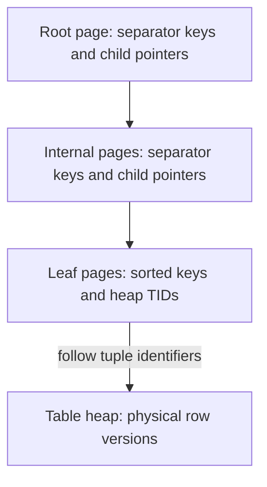

# Database Indexes

## Overview

An index is an auxiliary structure that helps locate rows, produce ordered results, or enforce uniqueness without examining every table row. It trades storage and write-maintenance work for faster access paths.

Indexing improves work on a database node; [replication](2_Replication.md), [sharding](3_Sharding.md), and [partitioning](4_Partitioning.md) address different bottlenecks. PostgreSQL-specific details below follow version 18.

## How an Index Is Physically Stored

PostgreSQL stores tables and indexes in separate on-disk relations made of fixed-size pages, normally **8 KiB**. Pages are cached in memory, but the index is a persistent structure, not just an in-memory lookup map. See [page layout](https://www.postgresql.org/docs/18/storage-page-layout.html).

For the default **B-tree**, the structure is approximately:



The tree is balanced and has high fan-out, so locating a key normally requires only a few page visits. Range queries find a starting position and then walk ordered leaf pages. Duplicate keys may share a posting list of tuple identifiers, rather than storing a complete repeated key for every row. See [PostgreSQL B-tree internals](https://www.postgresql.org/docs/18/btree.html).

In an ordinary index scan, PostgreSQL follows a heap tuple identifier, or TID, to a row version and checks visibility under MVCC. An index does not normally contain the complete row. Even the primary-key index is separate from the heap; it does not keep PostgreSQL table rows permanently sorted by primary key. Other databases can use a different clustered-storage design.

An **index-only scan** can return data from the index, but PostgreSQL must still establish visibility. If a heap page is not marked all-visible in the visibility map, heap visits may remain necessary. See [index-only scans](https://www.postgresql.org/docs/18/indexes-index-only-scans.html).

## Main Index Types

| Type | Structure / strength | Typical predicates |
| --- | --- | --- |
| B-tree | Ordered balanced tree | Equality, ranges, compatible ordering, min/max access |
| Hash | Hash-based equality lookup | Equality only; no range/order benefit |
| GIN | Inverted entries mapping elements/terms to matching rows | Array membership, supported JSONB containment and text-search operations |
| GiST / SP-GiST | Extensible search structures | Supported geometric, range, nearest-neighbor, and other specialized operators |
| BRIN | Summaries of ranges of heap pages | Very large tables where indexed values correlate with physical row placement |

An index must support the query's operators and operator class. For example, an ordinary B-tree does not directly solve arbitrary `LIKE '%fragment%'` searches. See [index types](https://www.postgresql.org/docs/18/indexes-types.html).

## Which Columns Are Worth Indexing?

Start with important query patterns, not a list of columns to index automatically. Good candidates include frequently searched identifiers, join keys, selective filters, and columns supporting common range/order/limit queries.

**Cardinality** is the number of distinct values. For access-path reasoning, the important question is **what fraction of rows a particular predicate matches**. Here, a highly selective predicate means one matching relatively few rows. High cardinality often helps equality lookups, but skew and query shape matter more than the data type alone.

| Field / workload | Assessment |
| --- | --- |
| Unique email queried by equality | Usually a strong candidate; a unique index can also enforce the rule |
| Customer ID used for joins and scoped lookups | Often useful; value frequencies may be uneven |
| Timestamp queried over a narrow range | Often useful; consider B-tree or BRIN depending on correlation and scale |
| Boolean split approximately 50/50, retrieving full rows | Standalone index often saves too little heap work |
| Boolean where only 0.1% of rows need processing | A selective full or partial index can be valuable |
| Enum/status with few values | Evaluate each value's frequency and the requested ordering/limit |
| Rarely queried, frequently changed field | Maintenance cost may outweigh query benefit |
| Small table or query returning most rows | Sequential scanning may be cheaper |

There is no universal percentage cutoff. Table width, cache state, storage, correlation, covering ability, and result size affect the plan. Statistics record distinct counts, common-value frequencies, and distributions; keep them current with `ANALYZE`. See [planner statistics](https://www.postgresql.org/docs/18/planner-stats.html).

### Boolean and Enum Example

Assume a large queue is mostly completed, while a small fraction of rows are pending:

```sql
CREATE TABLE tasks (
    id bigint PRIMARY KEY,
    tenant_id bigint NOT NULL,
    status text NOT NULL CHECK (status IN ('PENDING', 'RUNNING', 'DONE')),
    archived boolean NOT NULL DEFAULT false,
    created_at timestamptz NOT NULL
);

CREATE INDEX tasks_pending_created_idx
ON tasks (created_at, id)
WHERE status = 'PENDING';

SELECT id
FROM tasks
WHERE status = 'PENDING'
ORDER BY created_at, id
LIMIT 100;
```

`status` has low cardinality, but the index is useful because it contains only the important subset and orders it for the query. The same pattern can use a predicate such as `WHERE archived = false` if that subset and workload justify it.

If most rows match the predicate, the partial index is not small just because it is partial. The planner must also be able to establish that the query implies the index predicate; generic parameterized plans cannot always prove this. See [partial indexes](https://www.postgresql.org/docs/18/indexes-partial.html).

## Composite Indexes and Column Order

A B-tree on `(tenant_id, status, created_at)` is ordered **lexicographically**: first by tenant, within each tenant by status, and within that pair by time. It is not three independent indexes.

```sql
CREATE INDEX tasks_tenant_status_created_idx
ON tasks (tenant_id, status, created_at);
```

| Query condition | How this index helps |
| --- | --- |
| `tenant_id = 42` | Leading prefix gives a contiguous tenant range |
| `tenant_id = 42 AND status = 'PENDING'` | Longer equality prefix narrows the range |
| Those equalities plus a `created_at` range | Natural equality-prefix plus range access |
| `tenant_id = 42` plus a time range, without status | Tenant narrows access; time may require searching across status groups |
| `status = 'PENDING'`, without tenant | No conventional leading prefix; may require broad scanning or skip scan |
| Only a time range | May inspect much more index data than a dedicated time index |

Leading equalities and the first range condition are the main starting rule for B-tree navigation. Conditions farther right can still be checked in the index, reducing heap visits even when they do not narrow one contiguous scan range.

**PostgreSQL 18 supports B-tree skip scan:** when omitted leading columns have sufficiently few distinct values, the planner can perform repeated searches for their groups using later-column conditions. This is cost-based, not a promise that a missing prefix is cheap. It is incorrect to say a composite index can *never* be used without its first column. See [multicolumn indexes](https://www.postgresql.org/docs/18/indexes-multicolumn.html).

Column order should fit the workload's equality filters, range filters, and ordering. “Always put the most selective column first” is not a complete rule: when two leading columns both have equality conditions, either order can find that pair, while the order changes which prefix-only queries benefit.

### Sorting and Separate Indexes

With tenant and status fixed, the composite index can provide `created_at` order. With only tenant fixed, its order is primarily status then time, so it does not directly provide a global time ordering across that tenant's statuses. A separate `(tenant_id, created_at)` index may fit that query better.

Indexes on `a` and `b` can sometimes be combined through bitmap scans for `AND`/`OR` predicates. This differs from an ordered `(a, b)` index: bitmap heap access loses index ordering and can require a sort. See [combining indexes](https://www.postgresql.org/docs/18/indexes-bitmap-scans.html) and [ORDER BY](https://www.postgresql.org/docs/18/indexes-ordering.html).

## Covering and Expression Indexes

`INCLUDE` stores extra payload without making those columns search-order keys:

```sql
CREATE INDEX tasks_tenant_created_cover_idx
ON tasks (tenant_id, created_at)
INCLUDE (id, status);

SELECT id, status
FROM tasks
WHERE tenant_id = 42
ORDER BY created_at
LIMIT 20;
```

This can support an index-only scan. `INCLUDE (status)` does not give status the navigation role it would have as a key column, and included columns do not participate in a unique index's uniqueness rule. Large payloads increase index size and write cost.

For a query over an expression, index the matching expression when appropriate:

```sql
CREATE TABLE users (id bigint PRIMARY KEY, email text NOT NULL);
CREATE UNIQUE INDEX users_lower_email_idx ON users (lower(email));
SELECT id FROM users WHERE lower(email) = 'alice@example.com';
```

An index on raw `email` is not the same as an index on `lower(email)`. Similarly, prefer a directly usable time range over wrapping every timestamp in an unmatched function. See [expression indexes](https://www.postgresql.org/docs/18/indexes-expressional.html).

## Costs and Validation

- Inserts and relevant updates maintain indexes, generating additional CPU, I/O, WAL, and cache pressure; deletions leave cleanup work for vacuum.
- Wider and redundant indexes consume memory and storage. Changes to indexed columns can also reduce opportunities for PostgreSQL HOT updates.
- Unique indexes enforce constraints as well as provide access paths. PostgreSQL automatically indexes primary/unique constraints, but does not automatically index every referencing foreign-key column.
- An index cannot remove the cost of returning or aggregating a very large result set.

See [constraint-related indexes](https://www.postgresql.org/docs/18/ddl-constraints.html#DDL-CONSTRAINTS-FK).

Use representative data and inspect the real plan:

```sql
ANALYZE tasks;
EXPLAIN (ANALYZE, BUFFERS)
SELECT id FROM tasks
WHERE tenant_id = 42 AND status = 'PENDING'
ORDER BY created_at
LIMIT 100;
```

Compare estimates with actual rows, scan/filter work, heap fetches, buffer access, and latency. `EXPLAIN ANALYZE` actually executes the statement, including writes for DML. A sequential scan can be the correct plan. See [EXPLAIN](https://www.postgresql.org/docs/18/using-explain.html).

For live PostgreSQL tables, `CREATE INDEX CONCURRENTLY` permits ongoing writes but takes additional work and can wait on transactions. It cannot run inside a transaction block; failed builds can leave invalid indexes requiring attention. It is not a zero-impact operation. See [CREATE INDEX](https://www.postgresql.org/docs/18/sql-createindex.html).

## Best Practices

- Index expensive, important query patterns and verify their plans before and after changes.
- Measure value distribution and predicate selectivity, including uncommon boolean/enum values.
- Design composite ordering from actual filters, ranges, and sort/limit requirements.
- Prefer a focused partial or covering index when its benefit justifies maintenance cost.
- Review overlapping indexes and usage statistics, accounting for rare but essential workloads and constraint enforcement.

## Common Pitfalls

- **Indexing every column.** Writes and cache usage can deteriorate without useful query gains.
- **Declaring boolean/enum indexes always useless.** Rare values, ordering, and partial/covering designs can make them useful.
- **Treating a composite index as independent indexes.** Its ordered prefixes have different access characteristics.
- **Assuming a matching index must be used.** Planner estimates may correctly favor another path.
- **Expecting covering means zero heap reads.** MVCC visibility can still require heap access.

## Interview Questions

**Q: What is physically stored in a PostgreSQL B-tree index?**

A: Ordered index entries and heap tuple identifiers on leaf pages, with separator keys and downlinks on internal pages. It is separate from table storage.

**Q: Should a boolean or small enum be indexed?**

A: Sometimes. Evaluate the matching fraction and query shape; a rare value or a small ordered partial index can be useful even with very low cardinality.

**Q: Can an index on (a, b) help WHERE b = ...?**

A: Potentially, but it lacks a normal leading-prefix restriction. PostgreSQL 18 may use skip scan when leading-value groups are few; otherwise a dedicated index may be much cheaper.

**Q: Does (a, b) replace separate indexes on both columns?**

A: Not generally. It often helps a-only queries, but b-only queries and different ordering requirements may need other access paths.

**Q: Why might an index scan lose to a sequential scan?**

A: Fetching a large fraction of scattered heap rows can cost more than reading table pages sequentially.

**Q: How do key and INCLUDE columns differ?**

A: Keys determine navigation and order; INCLUDE columns provide payload for covering queries and do not extend the key's uniqueness rule.
