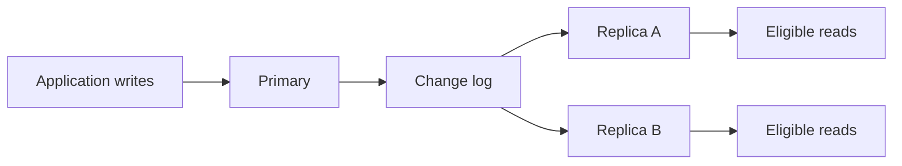

# Database Replication

## Overview

Replication maintains additional copies of database data by propagating changes between nodes. It supports availability, disaster recovery, read scaling, and data distribution for migrations or downstream workloads.

Replicas copy data; [shards](3_Sharding.md) divide it. Adding read replicas to a single-writer database does not distribute its primary write workload. PostgreSQL examples below refer to version 18.

## The Basic Flow



A replica needs an initial consistent copy, a position in the change stream, and ongoing application of subsequent changes. Sending, receiving, persisting, and replaying a change are separate stages; “the replica received it” does not necessarily mean queries can see it.

In PostgreSQL physical replication, standbys replay **Write-Ahead Log (WAL)** describing changes to database storage. Streaming replication sends records incrementally rather than waiting for whole archived WAL files. See [standby replication](https://www.postgresql.org/docs/18/warm-standby.html).

## Replication Dimensions

| Dimension | Options | Question it answers |
| --- | --- | --- |
| Write topology | Single leader, multiple leaders, leaderless designs | Which nodes accept and coordinate writes? |
| Acknowledgement | Asynchronous or synchronous | What must happen remotely before commit is acknowledged? |
| Representation | Physical or logical | What changes are transferred and applied? |

These are separate choices. Physical/logical does not by itself specify acknowledgement timing or conflict resolution. Multi-writer systems need a defined policy for concurrent updates; simply connecting replication streams in both directions does not provide one.

## Asynchronous vs. Synchronous

| Approach | Benefit | Cost / failure consequence |
| --- | --- | --- |
| Asynchronous | Primary commits without waiting for replica acknowledgement | Replicas can lag; promotion can lose acknowledged primary commits not present there |
| Synchronous | Commit waits for a configured acknowledgement condition | Additional latency and possible write unavailability if required acknowledgements cannot arrive |

Synchronous acknowledgement is not automatically “visible on every replica.” Specify the required replicas, number of acknowledgements, and stage: memory/OS write, durable flush, or application of changes.

### PostgreSQL Commit Modes

With synchronous standbys configured through `synchronous_standby_names`:

| `synchronous_commit` | Remote condition |
| --- | --- |
| `remote_write` | Required standby has written WAL to its operating system; not necessarily durable across an OS crash |
| `on` | Required standby has flushed WAL durably |
| `remote_apply` | Required standby has replayed the transaction, permitting visibility to new eligible snapshots |
| `local` | Wait for local WAL flush but not a remote acknowledgement |

`off` also relaxes local commit durability; it is not required merely to run asynchronous replication. Without a configured synchronous standby, `on` does not make a replica acknowledge commits.

Illustrative server configuration:

```conf
synchronous_standby_names = 'FIRST 1 (standby_a, standby_b)'
synchronous_commit = 'on'
```

This waits for one eligible priority-based synchronous standby, not both. Quorum-style selection can instead use `ANY`. Durability claims still depend on correct failover selection and the failures the deployment is designed to tolerate. See [commit settings](https://www.postgresql.org/docs/18/runtime-config-wal.html#GUC-SYNCHRONOUS-COMMIT).

## Physical and Logical Replication in PostgreSQL

| Aspect | Physical | Logical |
| --- | --- | --- |
| Change representation | WAL storage-level changes | Decoded table changes identified through replica identity |
| Usual scope | Whole database cluster/instance | Selected published tables, optionally rows/columns |
| Version compatibility | Normally same major version and compatible storage environment | Can support cross-major-version migration within documented compatibility limits |
| Subscriber layout | Mirrors primary storage/indexes | Independent storage and indexes; compatible target schema required |
| Standby writes | Physical standby is read-only during recovery | Subscriber is writable, but conflicting local changes need an explicit policy |
| Typical purpose | HA standby and read offload | Selective distribution, migrations, downstream copies |

Logical replication uses publications and subscriptions. Initial table copy is followed by change application. Updates/deletes require a usable replica identity, normally a primary key. Core logical replication does not automatically replicate DDL or sequence state; a subscriber is not automatically a complete failover replacement. See [logical replication](https://www.postgresql.org/docs/18/logical-replication.html), [replica identity](https://www.postgresql.org/docs/18/logical-replication-publication.html), and [restrictions](https://www.postgresql.org/docs/18/logical-replication-restrictions.html).

### Minimal Logical Replication Sketch

Assume a compatible `orders` table exists on both servers, its primary key identifies rows, and permissions, networking, slots, and `wal_level = logical` have been configured:

```sql
-- Publisher database:
CREATE PUBLICATION orders_publication FOR TABLE orders;

-- Subscriber database, a separate connection/server:
CREATE SUBSCRIPTION orders_subscription
CONNECTION 'host=publisher dbname=app user=replication_user'
PUBLICATION orders_publication;
```

This is the publication/subscription relationship, not a complete production setup. Subscriber-side local writes or incompatible schema changes can stop apply through conflicts. Within one subscription, publication changes preserve transactional consistency; independent subscriptions do not create one shared distributed snapshot.

## Read Scaling and Consistency

Common read-replica workloads include stale-tolerant reports, search/list pages, and analytics that do not need the latest commit. Each replica has its own CPU and cache, but still spends resources replaying writes.

A read immediately following a successful primary write can return stale data from an asynchronous replica. Even routing between two replicas can make a user appear to go backward if their replay positions differ.

| Requirement | Strategy |
| --- | --- |
| Must observe the just-committed change | Read from the primary, or use an explicit replay-position protocol |
| Some staleness is acceptable | Route to replicas within a defined freshness budget |
| Read-own-writes on a chosen physical replica | Wait until its replay LSN reaches a suitable post-commit primary LSN, then take a fresh read snapshot |
| Synchronous visibility requirement | `remote_apply` can help for acknowledged standbys; arbitrary replicas are not covered |

Time-based primary stickiness is a heuristic unless lag is strictly bounded. LSN-based routing must handle timeouts, failover/timeline changes, and snapshot scope. Waiting for replay does not refresh an old Repeatable Read snapshot. See [hot standby visibility](https://www.postgresql.org/docs/18/hot-standby.html) and [isolation levels](../locks/2_Isolation_Levels.md).

## Availability, Failover, and Backups

- **RPO** describes acceptable lost data; **RTO** describes acceptable restoration time. Asynchronous promotion and slow failover affect different objectives.
- Promotion must choose a sufficiently up-to-date replica, redirect clients, and fence the old primary so it cannot continue accepting writes. Otherwise split brain can produce conflicting histories.
- PostgreSQL supplies replication and promotion mechanisms, but complete automated failure detection, leader election, and client routing require an orchestration design.
- Replication copies accidental deletes and bad writes too. Keep independent backups and a tested point-in-time recovery procedure.

See [PostgreSQL failover](https://www.postgresql.org/docs/18/warm-standby-failover.html). Reconnection can leave clients uncertain whether a commit succeeded; idempotency keys and explicit outcome checks matter during retries.

## Monitoring and Operational Costs

On a physical primary:

```sql
SELECT application_name, state, sync_state,
       pg_wal_lsn_diff(pg_current_wal_lsn(), replay_lsn) AS replay_lag_bytes
FROM pg_stat_replication;
```

On a physical standby:

```sql
SELECT pg_is_in_recovery(),
       pg_last_wal_receive_lsn(),
       pg_last_wal_replay_lsn();
```

Inspect send/write/flush/replay progress separately, plus disk space, apply throughput, network latency, and replication-slot retention. Missing progress can produce null measurements; time since the last replayed transaction is not by itself a reliable lag measure on an idle database. See [replication statistics](https://www.postgresql.org/docs/18/monitoring-stats.html#MONITORING-PG-STAT-REPLICATION-VIEW).

Slots can retain WAL for an unavailable consumer until storage pressure becomes serious; configure retention limits and recovery procedures. Long standby queries may be cancelled to allow WAL replay. Feedback that reduces cleanup conflicts can increase primary bloat instead. See [slots](https://www.postgresql.org/docs/18/warm-standby.html#STREAMING-REPLICATION-SLOTS) and [standby conflicts](https://www.postgresql.org/docs/18/hot-standby.html#HOT-STANDBY-CONFLICT).

## Best Practices

- Define freshness, RPO, and RTO requirements before choosing topology and acknowledgement rules.
- Route consistency-sensitive reads deliberately; do not send every `SELECT` to a replica automatically.
- Test failover, fencing, reconnection, and backup restoration under realistic conditions.
- Monitor replay lag and retained WAL, and ensure replicas can keep up with sustained writes.
- Separate heavy analytical workloads when they interfere with the standby's recovery role.

## Common Pitfalls

- **Expecting replicas to multiply single-primary write capacity.** Every physical replica still applies that write stream.
- **Equating synchronous with immediately visible everywhere.** Acknowledgement scope and stage matter.
- **Using replication as the only backup.** Logical mistakes are replicated too.
- **Assuming logical replication copies all schema and sequence behavior.** DDL and sequence state need separate handling.
- **Ignoring the old primary after promotion.** It must not remain an independent writer.

## Interview Questions

**Q: What does replication scale most directly in a single-leader system?**

A: Eligible reads and availability. The primary still handles writes, and replicas must replay them.

**Q: Why can a replica return stale data after a successful commit?**

A: The commit may be acknowledged before that replica receives or replays it; an existing read snapshot can also remain older.

**Q: Does synchronous replication eliminate every data-loss scenario?**

A: No. It protects the configured acknowledgement condition and failure scope; failover choice, correlated failures, and acknowledgement stage still matter.

**Q: How do PostgreSQL physical and logical replication differ?**

A: Physical replication replays storage-level WAL for a cluster; logical replication applies selected table changes to independently managed subscriber storage.

**Q: Why is fencing necessary?**

A: To prevent a former primary from accepting conflicting writes after another node is promoted.
