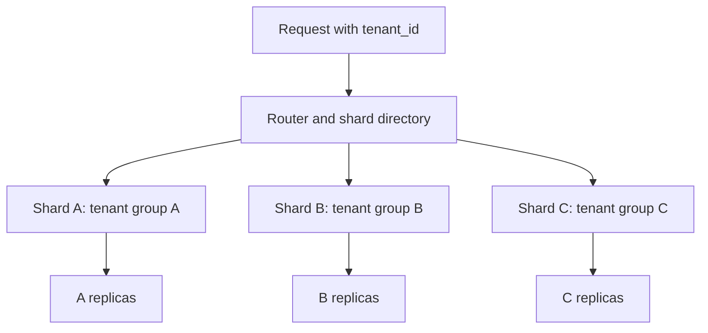

# Database Sharding

## Overview

Sharding distributes different subsets of a dataset across database nodes. Each shard owns part of the data and serves its share of storage, reads, and writes. This can exceed the capacity of one database server.

In these notes, [partitioning](4_Partitioning.md) means splitting a table within a database, while sharding emphasizes distribution across nodes. Terminology varies: sharding is also called distributed horizontal partitioning. [Replication](2_Replication.md) copies a shard's data for availability or reads; it does not replace distribution.

## When Sharding Is Worth Considering

- Sustained writes, storage, or working-set size exceed what one adequately tuned node can handle.
- Work can be divided into mostly independent tenant/entity scopes.
- Different groups of data need placement in different regions or failure domains.

Before adding a distributed data model, investigate [indexes](1_Indexes.md), query plans, connection limits, retention, [local partitioning](4_Partitioning.md), and vertical scaling. Sharding adds routing, movement, and failure-handling complexity; it is not a substitute for efficient queries. See the [sharding pattern](https://learn.microsoft.com/en-us/azure/architecture/patterns/sharding).

## How Requests Find Their Data



A router can live in application code, a proxy/coordinator, or a distributed database. It uses a **shard key** and a placement rule/directory. Replication and shard ownership are distinct: the directory must find the current leader/endpoint for the owning shard when writes require it.

```text
placement = directory.lookup(tenant_id)
connection = connections.for_shard(placement.shard)
execute parameterized SQL using tenant_id and the entity identifier
```

Routing to a shard is not authorization. Keep tenant predicates and access checks even when a shard happens to contain only the expected tenant today.

## Choosing the Shard Key

| Property | Why it matters |
| --- | --- |
| Present in common requests | Enables targeted routing instead of contacting every shard |
| Enough distinct values | Provides units that can be distributed and moved |
| Balanced data and traffic | Equal row counts do not imply equal CPU or write load |
| Stable over time | Changing the key may require moving rows and related data |
| Aligns related entities | Keeps joins and transactions on one shard |

`tenant_id` often works for multi-tenant applications because orders, customers, and permissions can be colocated. But one very large or busy tenant can become a hot shard. Splitting that tenant into smaller units changes the routing and transaction model; adding unrelated shards alone does not fix it.

Low-cardinality keys such as `active` or a three-value status provide few distribution groups. A monotonically increasing key with naive range placement can funnel new writes into the newest shard. See [distribution-column design](https://docs.citusdata.com/en/stable/sharding/data_modeling.html).

## Placement Strategies

| Strategy | Benefit | Cost / limitation |
| --- | --- | --- |
| Range | Related ranges stay together; useful for range routing | Skew and hot ranges; boundaries require management |
| Hash | Spreads many key values; efficient equality routing | Range queries can fan out; hash alone does not fix one hot key |
| Directory / lookup | Flexible placement and tenant moves | Routing metadata must be available, consistent, and refreshed safely |
| Virtual buckets / consistent hashing | Separates logical distribution units from physical nodes; can reduce remapping | Movement, metadata changes, and traffic balancing still need coordination |

The simple rule `stable_hash(key) % node_count` is deterministic only while the node count and algorithm stay fixed. Changing the count remaps many keys. Production designs often map stable logical buckets to nodes, so adding capacity moves selected buckets instead of redefining every key's destination.

## Colocation, Keys, and Queries

For tenant-scoped data, keep `tenant_id` on related tables and include it in routing, joins, and key design:

```sql
CREATE TABLE customers (
    tenant_id bigint NOT NULL,
    id bigint NOT NULL,
    name text NOT NULL,
    PRIMARY KEY (tenant_id, id)
);

CREATE TABLE orders (
    tenant_id bigint NOT NULL,
    id bigint NOT NULL,
    customer_id bigint NOT NULL,
    total numeric(12, 2) NOT NULL,
    PRIMARY KEY (tenant_id, id)
);

SELECT o.id, c.name, o.total
FROM orders AS o
JOIN customers AS c
  ON c.tenant_id = o.tenant_id AND c.id = o.customer_id
WHERE o.tenant_id = 42;
```

If the relevant rows are colocated, the join can remain local. Joining only on a shard-local `id` risks mixing tenants and can force unnecessary distributed work.

Small reference tables can sometimes be replicated to every shard. This makes local joins easier but adds a consistency/update policy for the copied reference data.

### Scatter/Gather Queries

Queries without a usable shard restriction may contact many or all shards, then merge results. Global aggregates, joins, sorting, distinct counts, and pagination require coordinator work and data transfer.

For global top-N results, each shard may produce candidates, but the coordinator still needs a correct merge and ordering. Distributed pagination also needs a stable ordering and an explicit consistency model. Overall latency can depend on the slowest shard, and partial failures need a policy rather than silently returning an incomplete result.

## Transactions and Global Constraints

Single-shard transactions can use that database's ordinary atomicity and [isolation](../locks/2_Isolation_Levels.md). Cross-shard operations require a distributed protocol or a business workflow designed for partial progress.

- A distributed transaction/2PC protocol can coordinate atomic commit, but adds communication, recovery state, and failure-handling costs; it does not make all nodes always available.
- A saga uses separately committed steps and compensations. It is not equivalent to one ACID rollback, especially for irreversible external effects.
- A unique index local to one shard does not enforce global uniqueness. Include the shard key in a scoped key, use a global coordination mechanism, or choose another explicit uniqueness design.
- Globally generated UUIDs or node-aware IDs can avoid common allocation collisions, but do not automatically provide a cross-shard unique constraint or gapless commit ordering.

Foreign-key and uniqueness support across shards depends on the distributed database's capabilities and colocation rules. Do not assume every SQL feature has the same cost and behavior as on one node.

Atomic commit and global isolation are separate guarantees: using 2PC alone does not establish a consistent cross-shard snapshot or serializable query execution.

## Resharding and Rebalancing

Moving data is an online migration problem, not just changing a routing formula. A typical migration needs:

1. Create the destination and copy a consistent starting dataset.
2. Capture and apply changes made during copying.
3. Validate row counts, content, constraints, and catch-up progress.
4. Coordinate a cutover so old routing cannot create diverging writes.
5. Redirect requests, handle in-flight work, and retire old copies after a defined recovery window.

Possible mechanisms include brief write pauses, change capture, ownership epochs, or carefully designed dual-write protocols. Naive dual writes can succeed on one shard and fail on the other. Retried requests need idempotency, and cached routing needs invalidation/redirect behavior.

Balance by observed request rate, storage, CPU, and latency rather than shard count alone. Consistent hashing can reduce how much data moves; it does not move the data or solve transaction cutover by itself.

## PostgreSQL-Specific Options

Core PostgreSQL declarative partitioning does not automatically distribute a normal table across independent servers with a complete shard-routing and distributed-transaction layer. Foreign tables can expose remote data, but foreign-table access alone is not a full sharding system.

Application-managed shards use separate PostgreSQL databases/clusters and explicit routing. Extensions or distributed PostgreSQL systems can provide additional distribution and coordination. For example, with **Citus installed and configured**, the tables above could be distributed and colocated as follows:

```sql
SELECT create_distributed_table('customers', 'tenant_id');
SELECT create_distributed_table('orders', 'tenant_id', colocate_with => 'customers');
```

These are extension functions, not built-in PostgreSQL commands. Check the chosen system's supported versions, transaction semantics, constraints, and rebalance behavior. Citus's [colocation model](https://docs.citusdata.com/en/stable/sharding/data_modeling.html) explains why a common distribution key is central to tenant-local queries.

Each shard can independently use indexes, local time partitions, and replicas. For example, distribute by tenant across nodes, partition each shard's history by month, and replicate each node for failover.

## Advantages and Costs

| Advantages | Costs |
| --- | --- |
| Distribute storage and write capacity across nodes | Application/routing and operational complexity |
| Keep tenant-local work on smaller working sets | Cross-shard queries and transactions become harder |
| Isolate some load and failure impact | Hot shards and uneven tenants still exist |
| Support selective regional placement | Resharding, schema rollout, backup, and recovery span many nodes |

## Best Practices

- Design the shard key from actual joins, transaction boundaries, and load distribution.
- Keep common requests single-shard and make global queries explicit.
- Make placement metadata, ownership changes, and idempotency part of the design.
- Test hot tenants, slow/unavailable shards, and resharding before capacity is exhausted.
- Monitor individual shards as well as the coordinator; averages can hide overloaded nodes.
- Define backup and recovery consistency across shards when cross-shard invariants matter.

## Common Pitfalls

- **Choosing a high-cardinality key without checking access patterns.** Uniform placement can still make every useful query distributed.
- **Assuming more shards fix one hot key.** That key still maps to one ownership unit unless redesigned.
- **Enforcing a global rule with only shard-local constraints.** Independent shards cannot see every conflicting write.
- **Changing hash modulo without moving existing data.** Old and new requests find different locations.
- **Treating dual writes as atomic replication.** Partial failures create divergence unless handled.

## Interview Questions

**Q: How does sharding differ from replication?**

A: Sharding distributes different data subsets and their work; replication maintains copies of those subsets.

**Q: What makes a good shard key?**

A: It enables common requests to route locally, balances data and traffic, remains stable, and colocates transactionally related records.

**Q: Why does a hash shard key not guarantee balanced load?**

A: Hashing spreads key values, not necessarily key popularity or size. One hot tenant can dominate its shard.

**Q: Why are cross-shard transactions expensive?**

A: They require coordination over a network and a recovery protocol for partial failures instead of one local commit boundary.

**Q: Does consistent hashing solve resharding?**

A: It can reduce remapping, but copying, catch-up, validation, and safe ownership cutover are still required.
