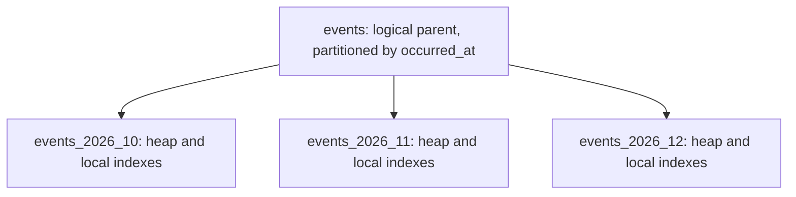

# Database Table Partitioning

## Overview

Partitioning divides one logical table into smaller physical pieces using a partition key and boundaries. It can reduce query work, simplify retention, and make maintenance more manageable.

Here, [sharding](3_Sharding.md) means distributing ownership across database nodes, while local partitioning remains within one database's resource envelope. Partitioning is not automatically horizontal server scaling. PostgreSQL-specific behavior below follows version 18.

## What It Solves

| Requirement | Potential benefit |
| --- | --- |
| Most queries access recent history | Prune old partitions and work on a smaller active set |
| Delete data by month/period | Detach/drop an old partition rather than deleting rows individually |
| Large indexes and maintenance windows | Maintain smaller physical tables/indexes separately |
| Separate hot/cold data | Place or manage partitions according to their lifecycle |

Partitioning can hurt when queries still touch everything, partitions are too numerous, or the chosen key does not match filters. It does not repair an inefficient join or remove the cost of returning a large result set. See [PostgreSQL partitioning](https://www.postgresql.org/docs/18/ddl-partitioning.html).

## Partitioning Strategies

| Strategy | Example | Trade-off |
| --- | --- | --- |
| Range | Monthly timestamp intervals | Good for time filters and retention; newest range can remain the write hotspot |
| List | Explicit region/category values | Clear placement for stable categories; new values need handling |
| Hash | Hash of tenant/entity ID | Spreads values among local partitions; does not itself distribute servers |
| Subpartitioning | Range by month, then hash by tenant | More targeted layout, but more objects and maintenance complexity |

This is horizontal table partitioning: each partition contains rows with the same logical columns. Vertical partitioning, such as moving large optional payload columns to a separate related table, is a different schema technique.

## How PostgreSQL Stores and Routes Data

A declaratively partitioned parent is a logical relation with no ordinary heap storage of its own. Leaf partitions store rows and have their own physical indexes. An insert through the parent is routed to a matching partition; a query through it can access the relevant descendants.



One transaction can access several local partitions without introducing a distributed commit protocol. Index navigation and MVCC still work inside each leaf. Updating a partition key can move a row between partitions, so it is not necessarily a cheap in-place field update.

## Example: Monthly Events

Use half-open time boundaries and explicit UTC timestamps:

```sql
CREATE TABLE events (
    id bigint NOT NULL,
    tenant_id bigint NOT NULL,
    occurred_at timestamptz NOT NULL,
    payload jsonb NOT NULL,
    PRIMARY KEY (occurred_at, id)
) PARTITION BY RANGE (occurred_at);

CREATE TABLE events_2026_10 PARTITION OF events
FOR VALUES FROM ('2026-10-01 00:00:00+00') TO ('2026-11-01 00:00:00+00');

CREATE TABLE events_2026_11 PARTITION OF events
FOR VALUES FROM ('2026-11-01 00:00:00+00') TO ('2026-12-01 00:00:00+00');

CREATE INDEX events_tenant_time_idx ON events (tenant_id, occurred_at DESC);

INSERT INTO events VALUES
    (1, 42, '2026-10-25 12:00:00+00', '{"type":"login"}');
```

The October interval includes its lower bound and excludes its upper bound. A row exactly at November 1 goes to November. Creating the index on the parent creates corresponding indexes for the partitions; it does not build one global physical index containing every row.

## Partition Pruning and Indexes

```sql
EXPLAIN (ANALYZE, BUFFERS)
SELECT id, occurred_at
FROM events
WHERE tenant_id = 42
  AND occurred_at >= '2026-10-01 00:00:00+00'
  AND occurred_at <  '2026-11-01 00:00:00+00'
ORDER BY occurred_at DESC
LIMIT 50;
```

Partition bounds allow PostgreSQL to exclude November. Inside October, the tenant/time index can locate and order the matching rows. **Pruning chooses partitions; an index chooses rows within them.** One does not replace the other.

Pruning can happen during planning or execution, including some parameterized cases. It follows partition bounds and usable predicates, not the existence of an index. An unmatched function around the partition key can make proving bounds harder; verify the real plan rather than assuming all date expressions prune identically. See [partition pruning](https://www.postgresql.org/docs/18/ddl-partitioning.html#DDL-PARTITION-PRUNING).

For a query using only `tenant_id`, monthly range partitions cannot be pruned by time. PostgreSQL may need to probe every partition's local tenant index. A lookup by `id` alone has the same issue unless some other routing information supplies the partition key.

## Other Partition Types

A list layout can explicitly separate categories:

```sql
CREATE TABLE regional_customers (
    id bigint NOT NULL,
    region text NOT NULL
) PARTITION BY LIST (region);

CREATE TABLE regional_customers_eu PARTITION OF regional_customers
FOR VALUES IN ('EU');
CREATE TABLE regional_customers_us PARTITION OF regional_customers
FOR VALUES IN ('US');
```

A hash layout can split many tenant keys among local tables:

```sql
CREATE TABLE tenant_records (
    tenant_id bigint NOT NULL,
    id bigint NOT NULL,
    PRIMARY KEY (tenant_id, id)
) PARTITION BY HASH (tenant_id);

CREATE TABLE tenant_records_0 PARTITION OF tenant_records
FOR VALUES WITH (MODULUS 2, REMAINDER 0);
CREATE TABLE tenant_records_1 PARTITION OF tenant_records
FOR VALUES WITH (MODULUS 2, REMAINDER 1);
```

Neither example creates independent database servers. Hash partitions can help with local layout, but the node's total CPU, I/O, and memory limits remain.

## Constraints and Uniqueness

PostgreSQL 18 does not provide an ordinary global unique index across arbitrary partitions. A parent `PRIMARY KEY` or `UNIQUE` constraint must include all partition-key columns, subject to the documented partition-key restrictions.

In the events example, `(occurred_at, id)` is unique, but **`id` alone is not guaranteed unique**: the same ID can appear with another timestamp. Adding the partition key to a constraint changes its meaning; it does not magically preserve a former global-ID rule.

Use an explicit ID-allocation/uniqueness design when global uniqueness is required. Also plan foreign keys around the actual key shape. See [declarative partitioning limitations](https://www.postgresql.org/docs/18/ddl-partitioning.html#DDL-PARTITIONING-DECLARATIVE-LIMITATIONS).

## Retention, Missing Partitions, and Maintenance

An insert with no matching partition fails unless a suitable default partition exists. Precreate future time partitions and monitor routing failures. A default partition can prevent immediate failures, but it can also hide missing maintenance and accumulate unexpected data.

To remove a period from the logical table while retaining it separately:

```sql
ALTER TABLE events DETACH PARTITION events_2026_10;
```

After detaching, the physical table remains available for archival or separate deletion. This avoids per-row deletion of that period, but it is still DDL: locking and concurrent-query effects matter. `DETACH PARTITION ... CONCURRENTLY` can reduce parent locking in supported situations, with restrictions and possible finalization work; it cannot run inside a transaction block. See [ALTER TABLE](https://www.postgresql.org/docs/18/sql-altertable.html).

Attaching an existing table can require validating its contents against bounds. Suitable validated `CHECK` constraints can avoid some scans, while default-partition contents may also need checking. Building parent-level indexes concurrently has limitations; a leaf-by-leaf build/attach strategy may be needed for large live partitioned tables. See [partition maintenance](https://www.postgresql.org/docs/18/ddl-partitioning.html#DDL-PARTITIONING-DECLARATIVE-MAINTENANCE).

## Choosing the Key and Granularity

- Match common filters and the data lifecycle. Time is attractive when both access and deletion are time-scoped.
- Choose partition sizes based on query ranges, growth, vacuum/index work, and retention operations, not a universal row-count threshold.
- Too-coarse partitions may not reduce enough work; too-fine partitions increase planning, metadata, locking, and operational overhead.
- Thousands of tiny tenant partitions can be worse than fewer well-designed hash/range partitions. Test the actual number of partitions and query shapes.
- Keep statistics current for leaves and the parent as needed; PostgreSQL does not automatically analyze a partitioned parent solely because child rows changed. Parent-level statistics may require explicit `ANALYZE`.

See [autovacuum and partitioned-parent statistics](https://www.postgresql.org/docs/18/routine-vacuuming.html#AUTOVACUUM).

Measure partition pruning, number of child scans, planning time, buffers, and execution latency. The useful metric is work avoided, not the number of partitions created.

## Advantages and Costs

| Advantages | Costs / limitations |
| --- | --- |
| Prune unrelated data and keep active working sets smaller | Queries missing the partition key can fan out across leaves |
| Efficient period-based archival/removal | Partition creation, attachment, retention, and monitoring must be automated |
| Smaller independent maintenance units | More relations/indexes and planning overhead |
| Different management policies for hot/cold pieces | Uniqueness and key design have constraints; one node's resource ceiling remains |

## Best Practices

- Partition for measured query/maintenance needs, and keep the design aligned with retention.
- Use explicit boundary/time-zone conventions and create future ranges ahead of time.
- Keep [indexes](1_Indexes.md) appropriate for queries within each leaf.
- Verify pruning using realistic literals and prepared-query parameters.
- Test DDL locks, missing/default partition behavior, and archival procedures before relying on them.
- Combine local partitions with [replication](2_Replication.md) or [sharding](3_Sharding.md) only when their separate benefits are needed.

## Common Pitfalls

- **Treating partitioning as automatic multi-server scaling.** Local partitions still share the database node.
- **Expecting every query to become faster.** Non-prunable queries can inspect many leaves.
- **Assuming the parent has one global physical index.** Its indexes are represented by partition-local structures.
- **Adding the partition key to a unique constraint without checking semantics.** Global uniqueness may become scoped uniqueness.
- **Calling detach/drop lock-free.** Metadata changes still have locking and dependency costs.

## Interview Questions

**Q: How does partitioning differ from sharding?**

A: Partitioning splits a logical table into physical pieces; in this context sharding additionally distributes ownership/work across database nodes.

**Q: What is partition pruning?**

A: Excluding partitions whose bounds cannot satisfy a query. It is separate from index access within the remaining partitions.

**Q: Why are time partitions useful for retention?**

A: A whole expired period can be detached or dropped without deleting each row individually, while accounting for DDL locking.

**Q: Can PostgreSQL enforce UNIQUE(id) on a table partitioned only by time?**

A: Not through an ordinary parent unique constraint omitting that partition key. A unique design including time has different semantics.

**Q: Does a query without the partition key still use indexes?**

A: It can use local indexes, but may need to access many partitions because it cannot prune them by that missing key.
